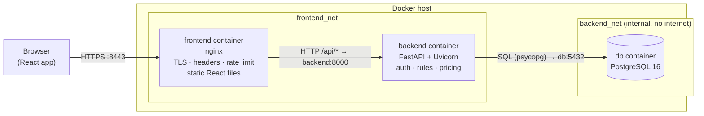
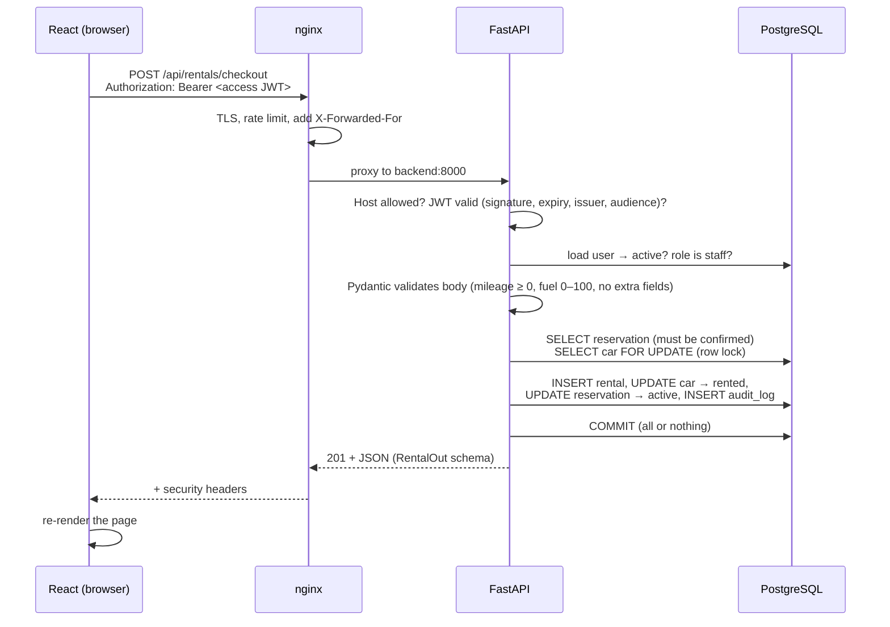
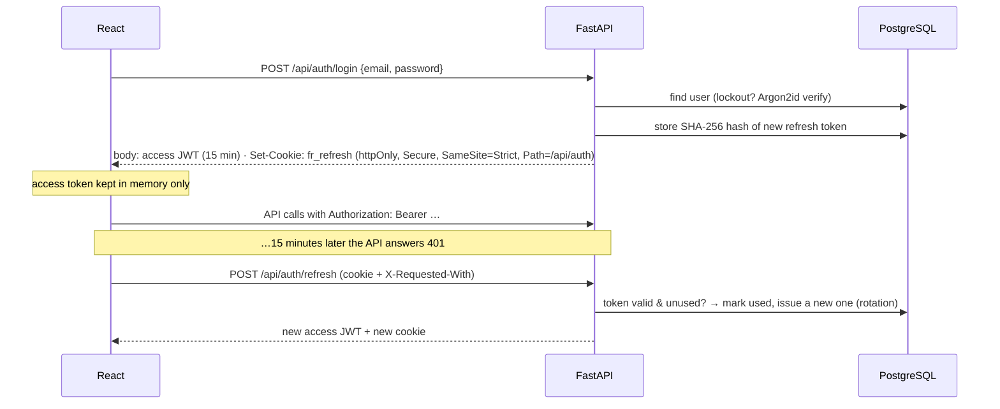

# How It All Works Together

This document explains how the technologies in FleetRent fit together, what each one does, and how a request travels through the system.

## The big picture



There are three containers, started together by **Docker Compose**:

| Container | Technology | Role | Reachable from |
|---|---|---|---|
| `frontend` | **nginx** serving the built **React** app | The front door: terminates HTTPS, adds security headers, rate-limits, serves the web app's files, forwards `/api/*` to the backend | The internet (the only published ports) |
| `backend` | **FastAPI** (Python) on **Uvicorn** | The brain: authentication, permissions, validation, business rules, pricing, audit log | nginx only |
| `db` | **PostgreSQL** | The memory: all data, plus constraints that guarantee data integrity | The backend only (internal network) |

---

## Each technology and why it is here

### React (frontend)
- React is a JavaScript library for building user interfaces. The app is written in **TypeScript** so type errors are caught at build time.
- **Vite** compiles it into a few static files: one HTML page, one JS bundle and one CSS file.
- **React Router** maps URLs like `/reservations/123` to screens, without reloading the page.
- The React app holds **no business logic that matters for security**. It shows data and sends requests. Every decision (who may do what, prices, availability) is made again by the backend.

### nginx (inside the frontend container)
nginx is a fast web server. Here it:
1. **Serves the React files** produced by Vite. Any unknown path returns `index.html`, so React Router can handle it.
2. **Terminates HTTPS.** Browsers only ever talk encrypted. Port 8080 just redirects to 8443.
3. **Adds security headers** to every response:
   - Content-Security-Policy, which blocks injected scripts
   - HSTS
   - X-Frame-Options, which stops other sites from framing the app
4. **Rate-limits** login and registration to 10 per minute per IP, and the API in general to 30 per second.
5. **Reverse-proxies** `/api/*` to `backend:8000`, overwriting `X-Forwarded-For` with the real client IP so it can't be spoofed.

Because the page and the API come from the **same origin** (same host and port), the browser needs no CORS. Cookies can be strict, too.

### FastAPI (backend)
FastAPI is a Python web framework. It turns Python functions into HTTP endpoints, and **Uvicorn** is the server that runs them.

Inside the backend:

```
request → TrustedHost check → route function
             │
             ├─ Depends(get_current_user)   verify JWT, load user, check it is active
             ├─ Depends(require_roles(...))  role check (agent / manager / admin)
             ├─ Pydantic schema              validate & reject unknown fields
             ├─ business rules               availability, age, license, status transitions
             ├─ services/pricing.py          all money math in one place
             ├─ SQLAlchemy ORM               safe parameterized SQL
             └─ services/audit.py            audit entry committed with the change
          → response (Pydantic output schema = only the fields we choose to expose)
```

The libraries the backend uses:

| Library | Job |
|---|---|
| **Pydantic** | Validates every input (types, lengths, formats) and shapes every output. It is also how settings are read from environment variables. |
| **SQLAlchemy 2** | The ORM. Python classes in `app/models/` map to tables, and queries are always parameterized, which prevents SQL injection. |
| **Alembic** | Database migrations: versioned scripts that create and evolve the schema. They run automatically at container start. |
| **psycopg 3** | The PostgreSQL driver. |
| **argon2-cffi** | Password hashing with Argon2id. |
| **PyJWT** | Signs and verifies access tokens. |

### PostgreSQL (database)
PostgreSQL is a relational database. It stores branches, cars, users, customers, reservations, rentals, payments, maintenance records, refresh tokens and audit logs.

It also enforces rules itself, so they hold even if the application had a bug:
- an **exclusion constraint**: two pending, confirmed or active reservations of the same car can never overlap in time
- check constraints: payment `amount > 0` and `end_at > start_at`
- unique plates, VINs, license numbers and emails
- foreign keys that prevent deleting a car or customer that still has history

### Docker & Docker Compose
- **Docker** packages each part with exactly what it needs: Python and its libraries, nginx and the built files, PostgreSQL. It runs the same way on any machine.
- **Docker Compose** (`docker-compose.yml`) describes the three containers, how they're wired together, their health checks and start order (db → backend → frontend), and their security restrictions. One command (`docker compose up`) starts everything.
- **Volumes** keep data across restarts: `pg_data` holds the database and `tls_certs` holds the certificate.
- **Networks** isolate the containers. `backend_net` is marked `internal`, so the database has no internet access and can't be reached from the host.
- The **`.env` file** is the single place where secrets and settings live. Compose injects only the variables each container needs. The database never sees `SECRET_KEY`, and nginx never sees any secret.

---

## Life of a request

Here's what happens when an agent clicks **Confirm check-out**:



If anything fails, for example the car is already out, the transaction rolls back and the API returns a clear `409` error. React then shows that error to the user.

---

## How login and sessions work



- **Why two tokens?** The access token is short-lived and never stored on disk, so stealing it has little value. The refresh token can't be read by JavaScript at all, because it's httpOnly, so a script injection can't steal it.
- **Rotation and reuse detection.** Each refresh token works once. If a used token is presented again, someone may have copied it, so the whole session family is revoked and the event is logged.
- **Reloading the page.** The in-memory token is lost on reload, so the app calls `/auth/refresh` at startup and the cookie restores the session.
- **Instant revocation.** Changing a password, role or active status revokes every refresh token. Access tokens issued before a password change are rejected, too.

---

## Startup sequence

1. `docker compose up` starts **db**. Its health check (`pg_isready`) passes once it accepts connections.
2. **backend** starts after the db is healthy and runs `entrypoint.sh`:
   1. `alembic upgrade head` creates or updates the tables.
   2. `python -m app.initial_data` creates the first admin from `.env`, plus demo data if enabled. It's safe to run on every start.
   3. Uvicorn starts the API. The health check calls `/api/health`.
3. **frontend** starts after the backend is healthy. If no certificate exists, it generates a self-signed one, fills in the nginx config from its template, and starts serving.

---

## Where to change things

| I want to… | Edit |
|---|---|
| change prices of extras, deposits, fees | `backend/app/services/pricing.py` and `backend/app/core/config.py` |
| add a field to cars | `backend/app/models/fleet.py` + `schemas/fleet.py` + a new Alembic migration + `frontend/src/pages/CarsPage.tsx` |
| add an API endpoint | a file in `backend/app/api/routes/`, registered in `app/main.py` |
| add a screen | a file in `frontend/src/pages/`, a route in `App.tsx`, a link in `components/Layout.tsx` |
| change security headers or rate limits | `frontend/nginx/` |
| change ports, secrets, hostnames | `.env` |
